

# راهنمای کار با پنل مدیریت

این راهنما برای مدیر سایت است و نیازی به دانش فنی ندارد. پنل در آدرس `آدرس‌سایت/admin` باز می‌شود.

> تصاویر این راهنما با داده‌های نمونه گرفته شده‌اند. نام‌ها و پیام‌ها ساختگی‌اند.

## ورود

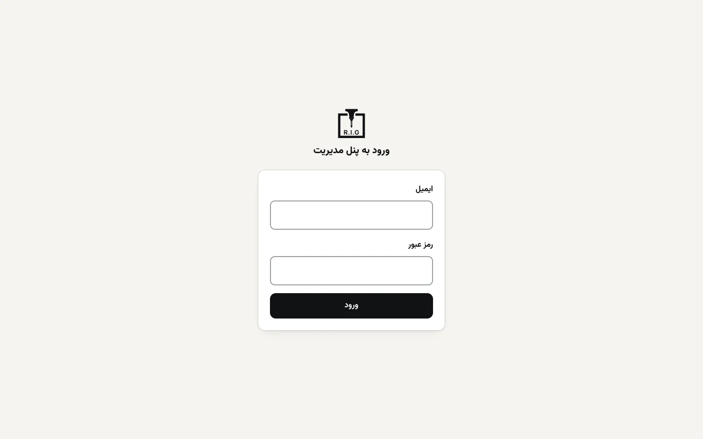

ایمیل و رمزی را که هنگام نصب برای شما ساخته شده وارد کنید. بعد از اولین ورود، از منوی **حساب کاربری** رمز را عوض کنید.

## آشنایی با صفحه

منوی تیره در سمت راست است و در گوشی با دکمهٔ **منو** باز می‌شود. بالای صفحه دکمهٔ **مشاهده سایت** را می‌بینید که سایت را در تب جدید باز می‌کند.

زیر هر فرم، یک نوار ثابت با دکمهٔ نارنجی **ذخیره تغییرات** است. بعد از ذخیره، پیام سبز «✓» می‌آید و **تغییر همان لحظه روی سایت دیده می‌شود**. اگر خطایی باشد، پیام قرمز کنار دکمه می‌آید.

## پیشخوان

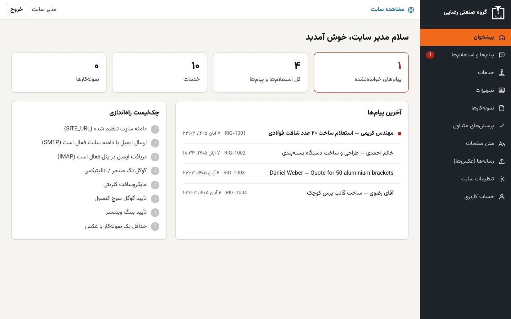

- بالا: تعداد پیام‌های خوانده‌نشده، کل استعلام‌ها، خدمات و نمونه‌کارها.
- **آخرین پیام‌ها**: با کلیک روی هر مورد، گفتگو باز می‌شود.
- **چک‌لیست راه‌اندازی**: نشان می‌دهد چه کارهایی مانده است (دامنه، ایمیل، آمارگیر، تأیید گوگل و بینگ، افزودن نمونه‌کار). هر مورد که انجام شود سبز می‌شود.

## پیام‌ها و استعلام‌ها

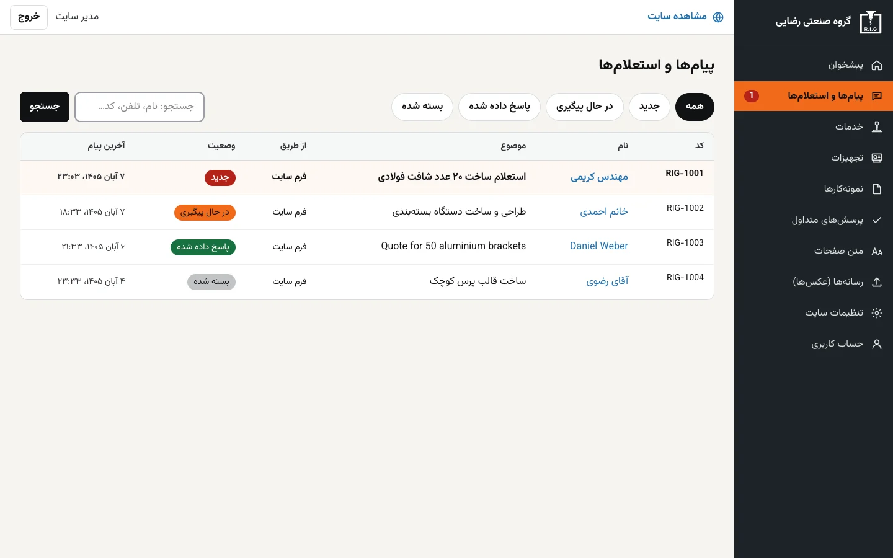

همهٔ استعلام‌های فرم سایت و ایمیل‌هایی که مستقیم به ایمیل شرکت می‌آیند اینجا جمع می‌شوند. عدد قرمز کنار منو تعداد پیام‌های جدید است.

- با دکمه‌های **جدید**، **در حال پیگیری**، **پاسخ داده شده** و **بسته شده** فهرست را فیلتر کنید.
- در کادر جست‌وجو، نام، تلفن یا کد پیگیری (مثل `RIG-1002`) را بنویسید.
- هر گفتگو یک کد پیگیری دارد که به مشتری هم داده می‌شود.

### پاسخ دادن

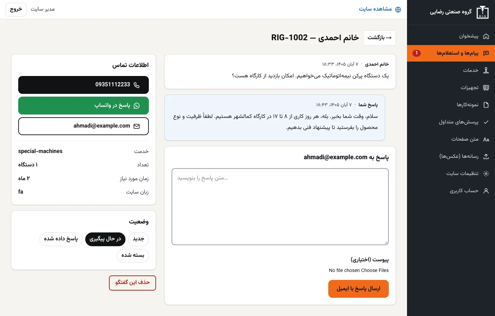

1. روی پیام کلیک کنید.
2. در سمت چپ، مشخصات تماس و سفارش (خدمت، تعداد، جنس، زمان) و فایل‌های پیوست را می‌بینید.
3. متن پاسخ را در کادر بنویسید. اگر لازم است فایلی (مثلاً پیشنهاد قیمت) پیوست کنید.
4. **ارسال پاسخ با ایمیل** را بزنید. پاسخ از ایمیل شرکت (مثلاً `info@دامنه`) برای مشتری می‌رود.
5. جواب مشتری خودش در همین گفتگو ثبت می‌شود و دوباره اعلان می‌گیرید.

اگر مشتری ایمیل نداده و فقط تلفن دارد، دکمه‌های **تماس** و **پاسخ در واتساپ** را بزنید.

### وضعیت گفتگو

در کادر **وضعیت** یکی از چهار حالت را انتخاب کنید. با باز کردن یک پیام جدید، وضعیت آن خودکار «در حال پیگیری» می‌شود. وقتی سفارش تمام شد، آن را **بسته شده** کنید. دکمهٔ **حذف این گفتگو** برای همیشه پاک می‌کند و قبلش تأیید می‌گیرد.

> اگر نقشهٔ مشتری پیوست باشد، فقط شما (واردشده به پنل) می‌توانید دانلودش کنید.

## خدمات

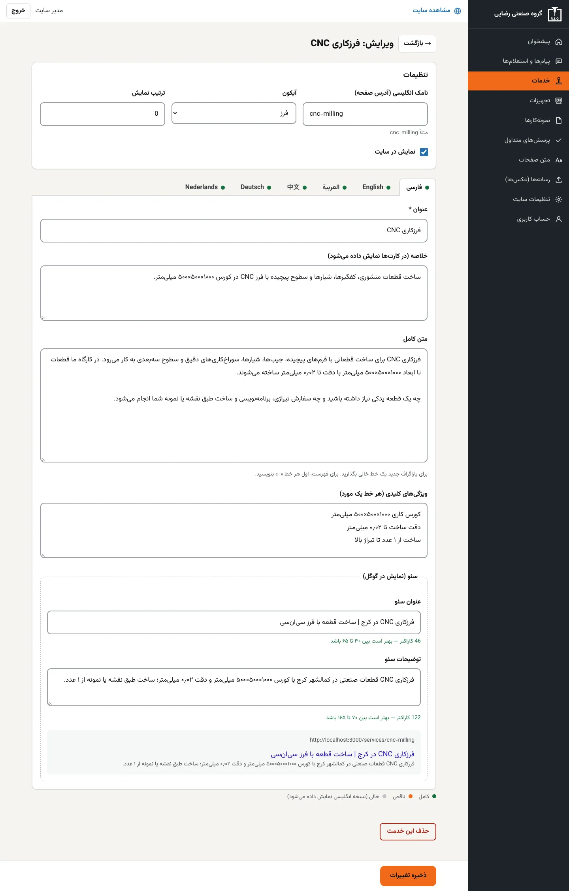

هر خدمت یک صفحهٔ جدا در سایت دارد. برای ویرایش، روی آن کلیک کنید.

- **نامک انگلیسی**: بخش آخر آدرس صفحه (مثل `cnc-milling`). بعد از انتشار، تغییرش نکنید چون آدرس عوض می‌شود.
- **آیکون** و **ترتیب نمایش**: عدد کمتر، بالاتر نمایش داده می‌شود.
- **نمایش در سایت**: اگر برداشته شود، خدمت پنهان می‌شود ولی پاک نمی‌شود.
- **زبانه‌های زبان**: بالای فرم برای هر شش زبان یک زبانه هست. نقطهٔ کنار نام زبان:
  - 🟢 سبز: کامل
  - 🟠 نارنجی: ناقص
  - ⚪ خاکستری: خالی (در سایت نسخهٔ انگلیسی نشان داده می‌شود)
- **سئو (نمایش در گوگل)**: عنوان و توضیحات را بنویسید. شمارنده نشان می‌دهد طول مناسب است یا نه (سبز یعنی خوب) و پایین، نمونهٔ آنچه در گوگل دیده می‌شود را می‌بینید.
- متن بلند: برای پاراگراف جدید یک خط خالی بگذارید و برای فهرست، اول هر خط `-` بنویسید.

> با ذخیرهٔ یک خدمت یا نمونه‌کار، بینگ و یاندکس خودکار خبردار می‌شوند تا زودتر آن را ببینند.

## تجهیزات

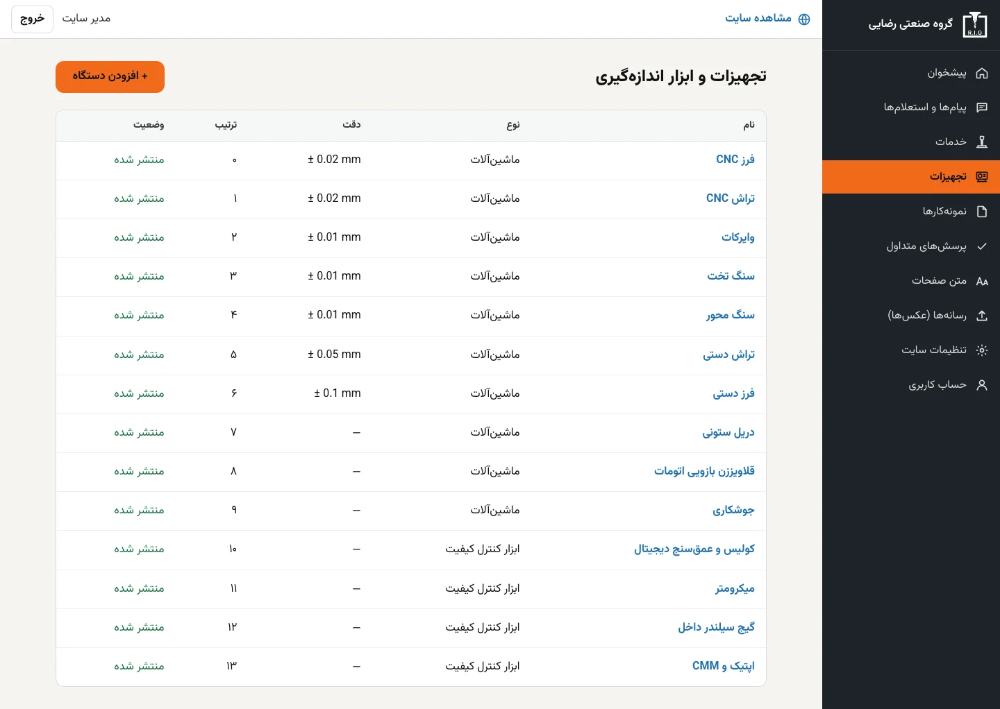

ماشین‌آلات و ابزار اندازه‌گیری شرکت. برای هر مورد نام، دقت و مشخصات فنی (ابعاد کاری و …) را به هر زبان وارد کنید.

## نمونه‌کارها

برای هر نمونه‌کار عنوان، خلاصه، توضیح، جنس و صنعت را بنویسید و چند عکس و خدمت مرتبط انتخاب کنید. **نام مشتری را ننویسید**؛ سایت عمداً بی‌نام است.

## پرسش‌های متداول

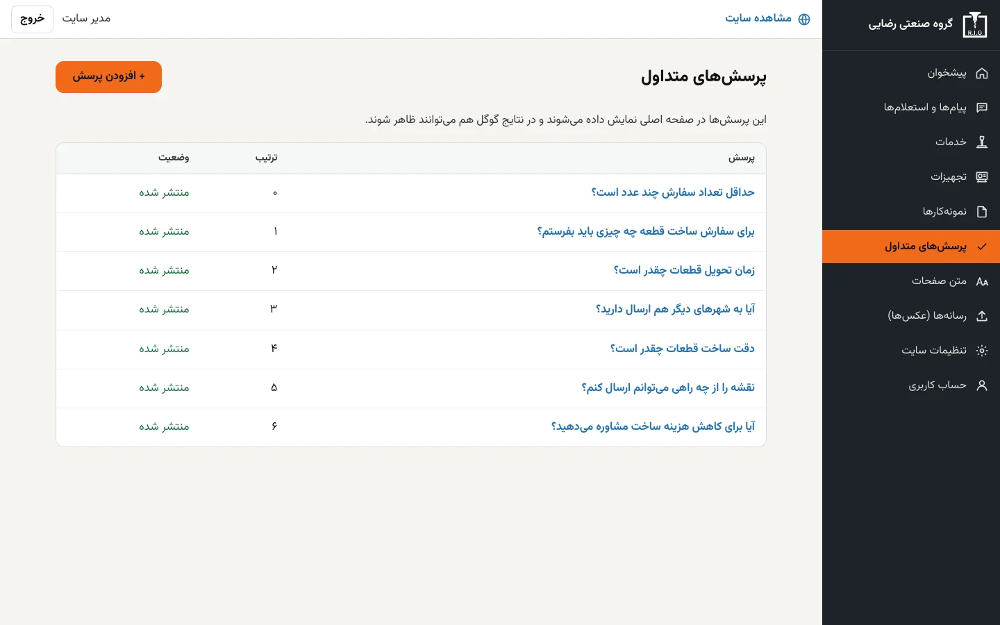

پرسش و پاسخ‌هایی که در صفحهٔ اصلی نمایش داده می‌شوند و در نتایج گوگل هم می‌توانند ظاهر شوند. هر مورد را به هر زبان بنویسید.

## متن صفحات

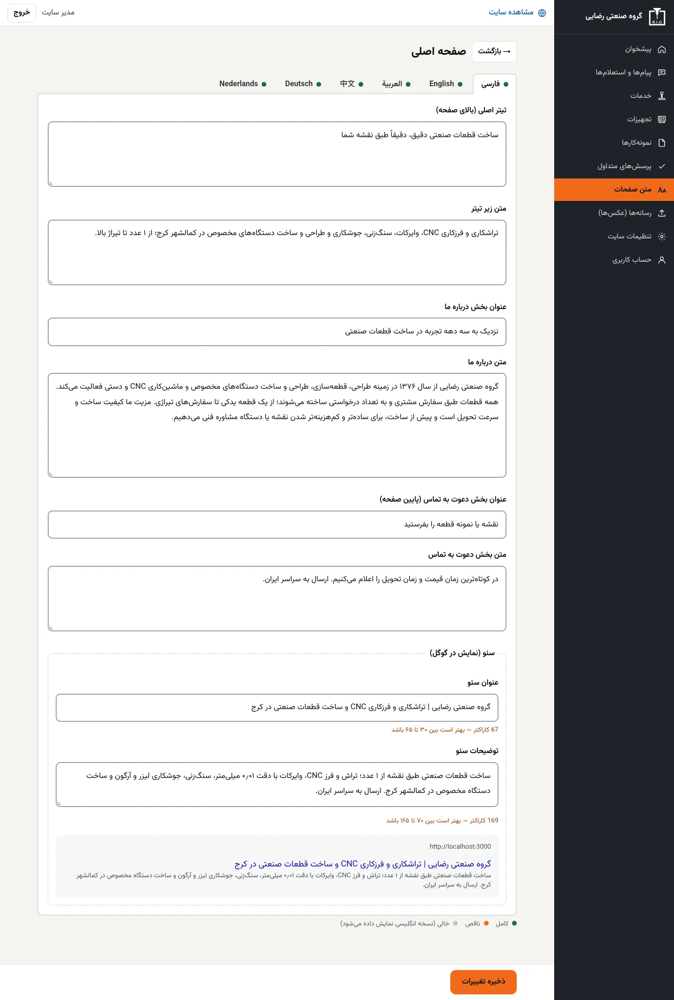

متن‌های اصلی صفحه‌ها، مثل تیتر بالای صفحهٔ اصلی و بخش «دربارهٔ ما»، و عنوان و توضیح سئوی هر صفحه.

## رسانه‌ها (عکس‌ها)

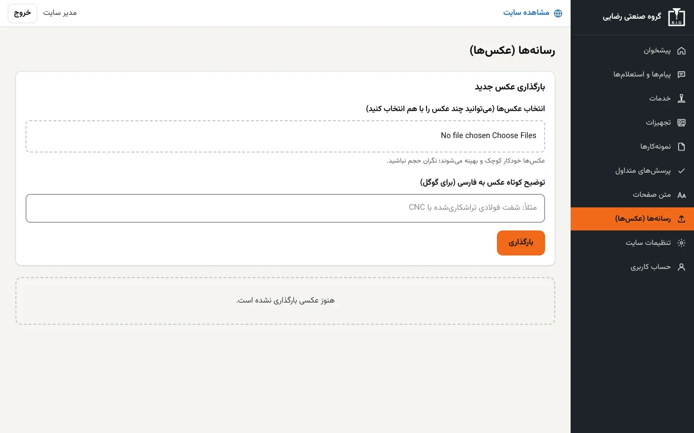

- عکس را انتخاب کنید و در صورت نیاز **متن جایگزین (alt)** بنویسید؛ هم برای کاربران نابینا و هم برای گوگل مهم است.
- عکس‌ها خودکار سبک و به فرمت WebP تبدیل می‌شوند (حداکثر ۲۰۰۰ پیکسل)، پس نیازی به کوچک‌کردن دستی نیست.
- بعد از بارگذاری، عکس را در صفحهٔ ویرایش خدمت یا نمونه‌کار انتخاب کنید.

## تنظیمات سایت

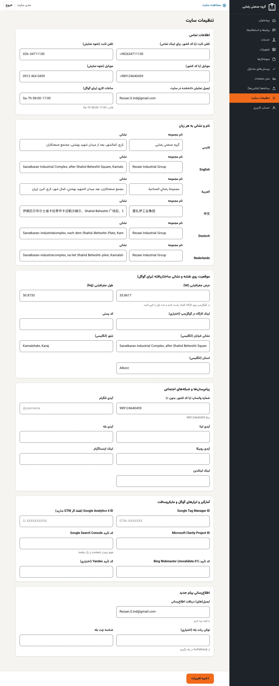

| بخش | چه چیزی وارد می‌شود |
|---|---|
| اطلاعات تماس | تلفن ثابت و همراه، ایمیل نمایشی و ساعات کاری (با قالب `Sa-Th 08:00-17:00`) |
| نام و نشانی به هر زبان | نام مجموعه و نشانی به هر شش زبان |
| موقعیت روی نقشه | طول و عرض جغرافیایی دقیق کارگاه، لینک گوگل‌مپ، کد پستی و نشانی انگلیسی برای گوگل |
| پیام‌رسان‌ها و شبکه‌ها | شناسهٔ تلگرام، ایتا، بله، روبیکا و … |
| آمارگیر و ابزارهای گوگل و مایکروسافت | شناسهٔ Tag Manager، Analytics، Clarity و کد تأیید Search Console و Bing |
| اطلاع‌رسانی پیام جدید | ایمیل‌هایی که با هر استعلام جدید خبر می‌گیرند و (اختیاری) ربات بله |

## حساب کاربری

تغییر نام و رمز. رمز قوی و یکتا انتخاب کنید و آن را به کسی نگویید.

## استفاده با گوشی

<table>
  <tr>
    <td width="50%" align="center">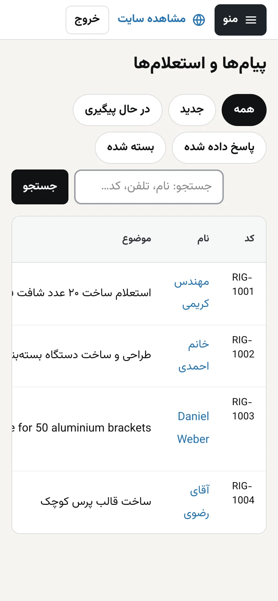</td>
    <td width="50%" align="center">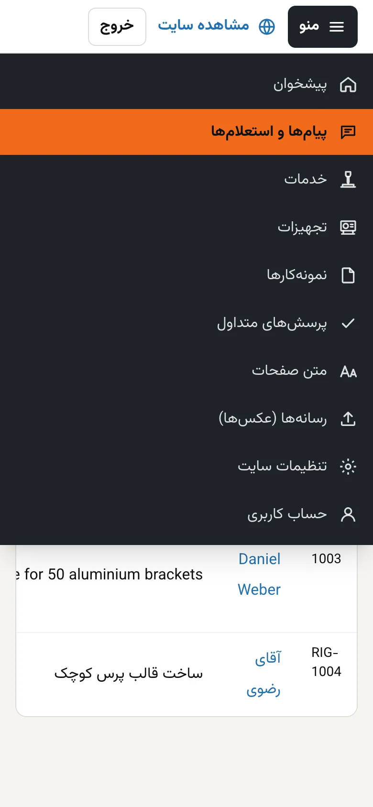</td>
  </tr>
</table>

پنل در گوشی هم کار می‌کند. فهرست پیام‌ها در عرض کم کنار هم می‌لغزد؛ برای دیدن همهٔ ستون‌ها آن را به چپ و راست بکشید.

## پرسش‌های رایج

**رمزم را فراموش کرده‌ام.** فعلاً بازیابی رمز از طریق ایمیل ندارد. از مسئول فنی بخواهید رمز را در سرور تغییر دهد.

**چرا تغییری که دادم در گوگل دیده نمی‌شود؟** سایت فوراً به‌روز می‌شود ولی گوگل چند روز تا چند هفته طول می‌کشد تا دوباره بخواند. این طبیعی است.

**ایمیل پاسخ به دست مشتری نرسید.** هنگام ارسال، پیام خطا کنار دکمه نمایش داده می‌شود. معمولاً دلیلش ناقص‌بودن تنظیمات ایمیل (`SMTP`) است. در «چک‌لیست راه‌اندازی» پیشخوان وضعیتش را ببینید.

**می‌خواهم زبانی را نشان ندهم.** زبان‌ها در کد تعریف شده‌اند و از پنل حذف نمی‌شوند. اگر ترجمه‌ای خالی بماند، نسخهٔ انگلیسی نمایش داده می‌شود.

